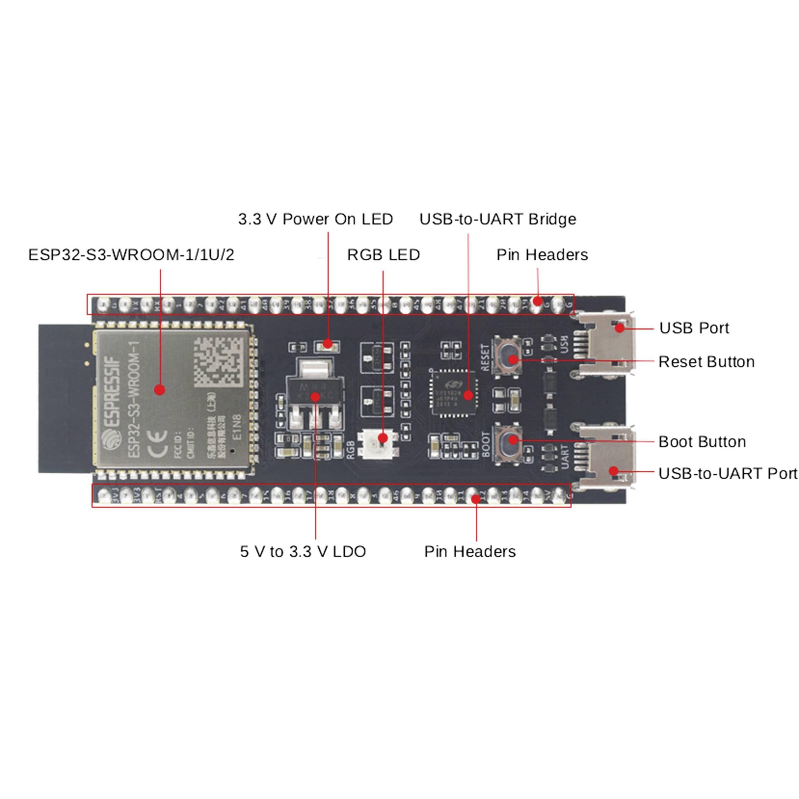
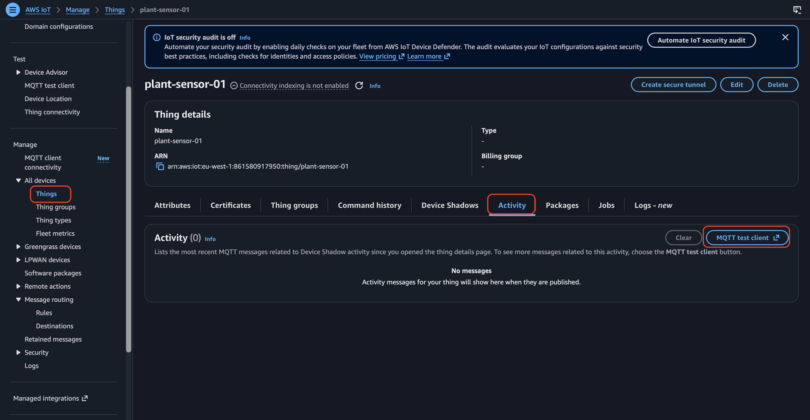

# Automatic Irrigation System

**Overview:** An automated system for watering house plant, this projects aims to build a system that collects soil moisture data at schedule and trigger watering process autonomusly.

## Glossary

- Actuators
- AC (50/60 time a sec)
- Baud Rate
- Bare electrode Probe
- Broker
- Circuits
- Client Certificate
- Current (Amperes, amps, A)
- CACertification
- DC
- Electricity
- GPIO: Genereal Purpose Input / Output
- High Potential Energy
- Lower Potential Energy
- MQTT
- Pin
- PrivateKey
- Resistance (Ohms)
- Real Time Clock (RTC)
- Relay Module
- Sensors
- Service Set Identifier (SSID)
- Transducers
- tls
- Voltage (Volts, V)
- VCC
- wifi

## Tech Stack

- TinkerCad
- Arduino IDE

## Setup

- Install python
- Create python virtual environment

```sh
cd automatic-irrigation-system

python3 -m venv venv

source ./venv/bin/activate

touch requirements.txt

pip3 install -r requirements.txt
```

## Components

- DC Water Pump
- 5v Relay Module (Active Low)
- Plastic Battery Holder (4 AA batteries)
- Soil Moisture Sensor
- 0.5m vinyl hose
- Two Dupont cables
- Transmitter module

## V1

- Get sensor readings
- Log sensor readings to database

**Project Log:**

- simulated soil moisture sensor `circuits` on `tinkercad`
- Connected physical components
  - Micro-controller - Arduino Uno
  - Breadboard
  - Soil moisture probe
  - Transmitter module
- Collect Measurement

**Observed Sensor Reading:**

Sensor in air -> 1023
Sensor in dry soil -> 950 - 850
Sensor in wet soil -> 250 - 300

- Flipped connected pins between transmitter and probe, observed

Sensor in air -> 1023
Sensor in dry soil -> 950 - 850
Sensor in wet soil -> 150 - 200

```txt
       Probe
      ┌──────┐
      │      │
      └──┬───┘
         │ 2 wires
         ▼
 ┌───────────────────────┐
 │  Transmitter module   │
 │    VCC GND DO AO      │
 └───────────────────────┘


Sensor module       Arduino
────────────────────────────
VCC        ───────── 5V
GND        ───────── GND
AO         ───────── A0
DO         ───────── (not connected)
```

## Pump

- Connected Relay module
  - 5V micro controller to VCC
  - GND micro controller to GND
  - GPIO to IN (RELAY)
- Connected Pump to Relay Module and battery holder
  - PUMP (+) to relay NO
  - Battery (+) to Relay CMD
  - Pump (-) to Battery (-)
- Tried Connecting a switch for manually controlling the pump for testing

```txt
              Microcontroller
              ┌──────────────┐
       5V ────┤ Relay VCC    │
      GND ────┤ Relay GND    │
     GPIO ────┤ Relay IN     │
              └──────────────┘

        Moisture Sensor
       VCC ───── 5V
       GND ───── GND
       OUT ───── GPIO


          5V Pump Supply
          + ───── COM
                    │
                    NO ───── Pump +
          - ──────────────── Pump -
```

**Observations:**

- Relay Stays ON when LOW signal is passed and OFF when HIGH signal is passed
- PUMP comes ON when RELAY is powered OFF and vice versa
- Connected switch is on stable with both normal and pull down connection

## IOT Core POC

- Setup IOT core to receive messages and store into dynamodb
- Write ESP32 sketch to send message to IOT core `ESP32-S3-WROOM-1-N16R8`

### What to configure in the AWS console

1. Create a Thing: name it `plant-sensor-01`. This represents your physical `ESP32` in `AWS`.
2. Create a `device certificate`: generate an `X.509 certificate` and `private key`. Activate the certificate.
3. Create an IoT policy: allow this device to connect and publish to its own telemetry topic. Avoid broad iot:* permissions.
4. Attach the policy and certificate: associate the policy with the certificate and the certificate with the Thing.
5. Get your endpoint: in AWS IoT Core, find the device data endpoint under Settings. You'll need the endpoint hostname in your sketch.

```sh
ping a2y4q11cpuh3v7-ats.iot.eu-west-1.amazonaws.com

unzip connect_device_package.zip
```

#### plant-sensor-01-Policy

```json
{
  "Version": "2012-10-17",
  "Statement": [
    {
      "Effect": "Allow",
      "Action": [
        "iot:Publish",
        "iot:Receive",
        "iot:PublishRetain"
      ],
      "Resource": [
        "arn:aws:iot:eu-west-1:861580917950:topic/sdk/test/java",
        "arn:aws:iot:eu-west-1:861580917950:topic/sdk/test/python",
        "arn:aws:iot:eu-west-1:861580917950:topic/sdk/test/js"
      ]
    },
    {
      "Effect": "Allow",
      "Action": [
        "iot:Subscribe"
      ],
      "Resource": [
        "arn:aws:iot:eu-west-1:861580917950:topicfilter/sdk/test/java",
        "arn:aws:iot:eu-west-1:861580917950:topicfilter/sdk/test/python",
        "arn:aws:iot:eu-west-1:861580917950:topicfilter/sdk/test/js"
      ]
    },
    {
      "Effect": "Allow",
      "Action": [
        "iot:Connect"
      ],
      "Resource": [
        "arn:aws:iot:eu-west-1:861580917950:client/sdk-java",
        "arn:aws:iot:eu-west-1:861580917950:client/basicPubSub",
        "arn:aws:iot:eu-west-1:861580917950:client/sdk-nodejs-*"
      ]
    }
  ]
}
```

## Configure ESP32



1. Connect micro-controller to breadboard


## Troubleshooting ESP32

```txt
Sketch uses 955694 bytes (72%) of program storage space. Maximum is 1310720 bytes.
Global variables use 47100 bytes (14%) of dynamic memory, leaving 280580 bytes for local variables. Maximum is 327680 bytes.
esptool v5.3.1
Serial port /dev/cu.usbmodem1234561:
Connecting......................................

A fatal error occurred: Failed to connect to ESP32-S3: No serial data received.
For troubleshooting steps visit: https://docs.espressif.com/projects/esptool/en/latest/troubleshooting.html
Failed uploading: uploading error: exit status 2
```

### Try the manual bootloader method

**Step 1 — Find BOOT and RESET**
Look for buttons labelled BOOT and RST or RESET on your development board. Their placement depends on the board model.

**Step 2 — Enter download mode**
Hold down BOOT.
While holding it, press and release RESET.
Release BOOT.

**Step 3 — Upload again**
Return to Arduino IDE and click Upload. If it starts writing the firmware, let it finish. If it still hangs at Connecting..., move to the checks below.

### Check message on IOT core




